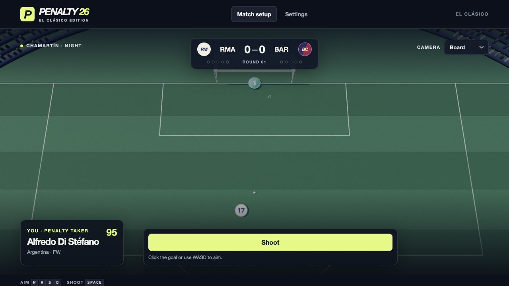

# PENALTY 26 — EL CLÁSICO EDITION

A 3D browser football game built around simulated penalty kicks. Pick Real Madrid CF or FC Barcelona, then play against the computer or another person. The game draws takers and keepers from a historical player database.



## Run locally

Use Node.js 22.12+ or 24 and a browser with WebGL 2.

```sh
npm ci
npm run dev
npm test
npm run build
npm run preview
```

Vite prints the local URL. The production build uses relative asset paths for GitHub Pages and requires no backend, paid API, or runtime asset download beyond the site bundle.

## Controls

| Action | Keyboard | Mouse or touch |
| --- | --- | --- |
| Aim | WASD or arrow keys | Swipe toward your target, click the goal with a mouse, or enable **Tilt to aim** on a supported phone |
| Take the kick | Space | Release your swipe, flick forward in tilt mode, or tap **Shoot** |
| Move the keeper | A/D or left/right | Hold **Move left** or **Move right** |
| Dive or jump | J/K/L; hold Shift for a low dive | Choose **Low dive** if desired, then tap **Dive left**, **Jump**, or **Dive right** |
| Advance after a kick | Enter | **Next penalty** |
| Change camera | Tab to the camera menu | Choose Board, Broadcast, Player, Center, Goal, or Sideline |

The **Player** camera frames the kicker close up. Choose **High** graphics for a higher render scale and dynamic shadows. Set volume above zero and start a kick to unlock Web Audio. The crowd swells at goals and boos or groans when a kick stays out. Optional commentary uses a voice supplied by the browser or operating system.

## Modes and selection

- **Vs AI** alternates player and computer kicks. You goalkeeper on the computer's turn. AI defenders act on observed flight after a reaction delay.
- **Local 2-player** lets each player choose either club and swap kicker and keeper roles each turn. Both sides may pick the same squad. The game draws a different famous outfield player for each of the first five kicks.
- **Practice** tracks goals and attempts without a shootout.

The shootout enforces alternating kicks, early victory, and equal-kick sudden death. The assigned keeper becomes the sixth eligible kicker. The first listed side takes the opening kick. This focused shootout game omits referee offences, retakes, substitutions, and dismissals. [IFAB Law 10](https://www.theifab.com/laws/latest/determining-the-outcome-of-a-match/) · [IFAB Law 14](https://www.theifab.com/laws/latest/the-penalty-kick/)

## Physics

Rapier advances the rigid-body simulation in **1/240 s** steps using SI units. The ball has a mass of **0.43 kg** and a radius of **0.11 m**. The spot is **11 m** from the line and the goal opening measures **7.32 × 2.44 m**. Cylindrical posts and the crossbar have a radius of **0.06 m**. A crossing is tested at the interpolated center position when the trailing surface of the ball passes the line.

| Quantity | Model |
| --- | --- |
| Launch | **J = m Δv**, with magnitude and direction derived from power, technique, timing, aim, foot choice, and contact offset |
| Gravity | **F = m g**, with g = 9.81 m/s² downward by default |
| Drag | **F = −½ ρ Cᴅ A ‖v‖ v**, with ρ = 1.225 kg/m³ and nominal Cᴅ = 0.25 |
| Spin lift | **F = ½ ρ A R k (ω × v)** with an empirical gain k |
| Energy | Translational **½mv²**, rotational **½Iω²**, and potential **mgy** |

CCD supplements fixed stepping. Rapier handles impulses, restitution, and Coulomb contact friction. The game adds a small rolling resistance force.

The drag and Magnus coefficients are simplified. Knuckleball wake forces are bounded oscillatory approximations, goalkeeper limbs are kinematic proxies, and the net uses rigid interaction surfaces with a damped visual wave. Squash is visual. The model uses a solid-sphere inertia approximation and does not model wind gusts, seam-dependent CFD, deformable mesh contact, or anatomically exact keeper contact. Real-time forces and event history are simulated; no goal probability or scripted shot path determines the outcome.

## Source layout

| Module | Responsibility |
| --- | --- |
| `physics.js` | Rapier world, ballistics, collisions, impact telemetry, scoring geometry |
| `game.js` | Kick lifecycle, match flow, input state, and replay frames |
| `rules.js` | Shootout scoring and early victory |
| `keeper.js` | Human and AI keeper commands, reaction delays, procedural pose |
| `render.js` | Three.js stadiums, cameras, instanced crowd, net, and aim marker |
| `animations.js` | Numbered 3D player pieces and animations |
| `players.js` | Club eligibility, roster traits, and custom ratings |
| `audio.js` | Web Audio ambience and effects, synthetic crowds, optional commentary |
| `tilt.js` | Screen-relative phone tilt aiming |
| `main.js` and `style.css` | Interface, controls, accessibility labels, and LocalStorage |

For future online play, authoritative services can own the fixed-step kick simulation and the shootout state. The client can send shot and keeper commands and consume snapshots using the existing replay frame shape. Online networking is outside this release.

## Provenance and verification

The database is a curated historical selection. Generation follows a representative in-game season. Attributes, appearance, kit variants, and shirt numbers are gameplay representations. The club histories corroborate many entries, including dual-club appearances, without providing a record-by-record audit of every in-game field. [Real Madrid football legends](https://www.realmadrid.com/en-US/the-club/history/football-legends) · [Barcelona legendary players](https://www.fcbarcelona.com/en/club/history/legendary-players) · [Barcelona historical player records](https://www.fcbarcelona.com/en/football/first-team/news/1938928/xavi-maradona-messi-and-ronaldo-in-the-ballon-dor-dream-team)

All game geometry, textures and audio are procedurally authored. Players appear on the pitch as animated, color-coded 3D discs displaying their shirt numbers. The two stadiums are inspired by Madrid and Barcelona venues. This is an independent fan game. The MIT license covers the project's original code and assets. Club and player names belong to their respective rights holders.

Run `npm test` for trajectory, spin, keeper and frame collision, ball crossing, player eligibility, mirror-match, and shootout regression tests.

## GitHub Pages

Select **Settings → Pages → GitHub Actions** for the repository. The workflow runs the tests, builds the app, and deploys `dist/` on pushes to `main`. Run **Test and deploy Pages** from Actions to deploy an existing revision manually.
